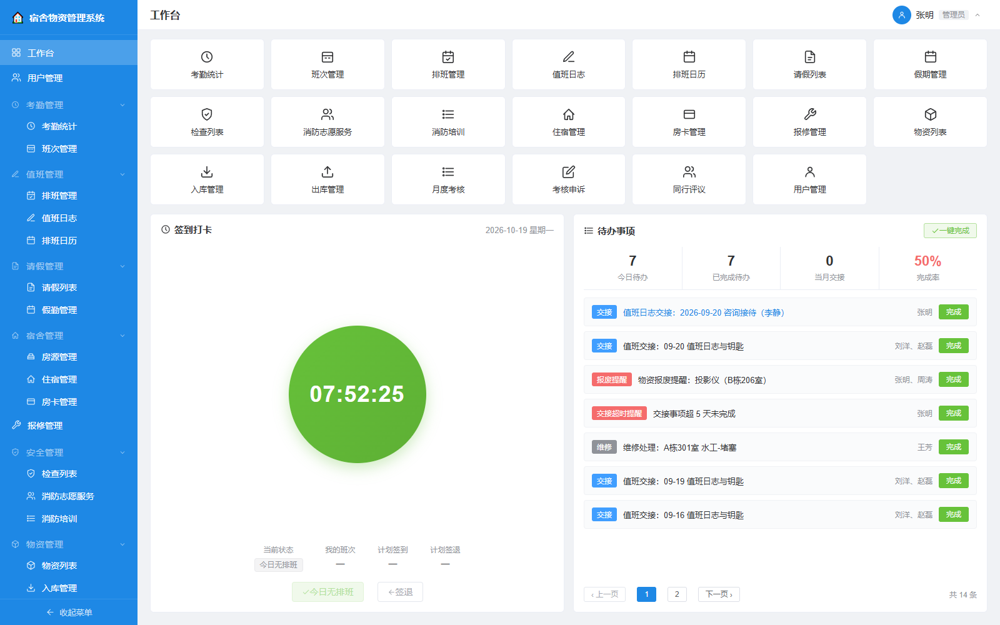
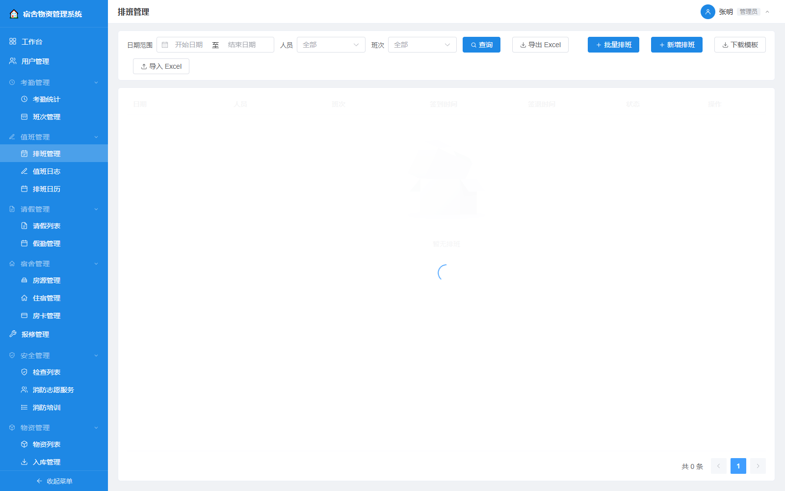
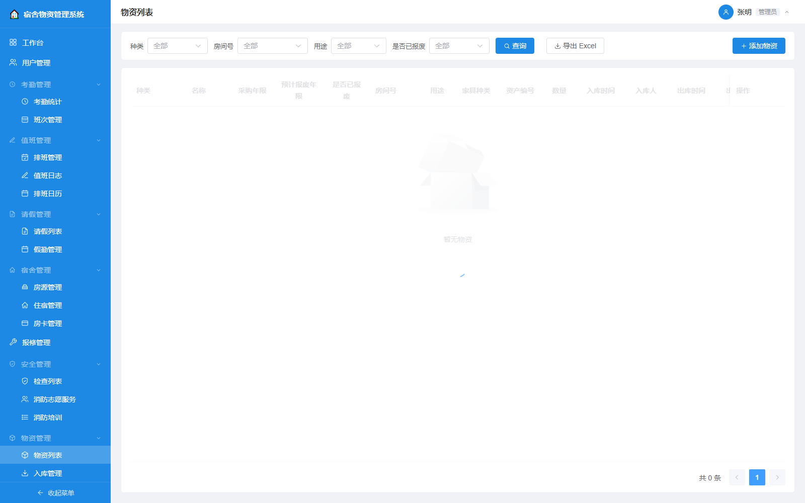
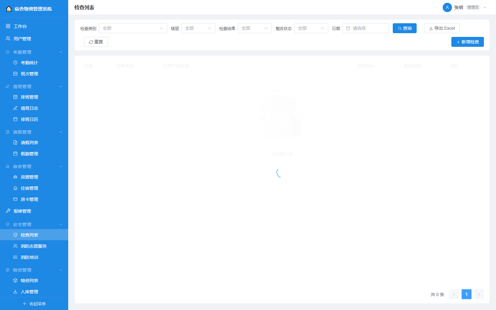
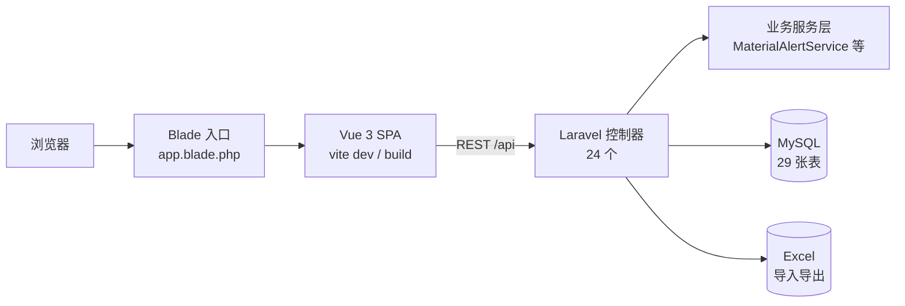

# 宿舍物资管理系统

面向单位宿舍、物资与值班场景的一体化管理平台：把**人员排班考勤、宿舍房源与住宿、物资进出库、消防安全检查、月度考核**这几摊原本分散在 Excel 和纸质台账里的事，收进一个系统里闭环。

> Laravel 12 + Vue 3 全栈，24 个前端页面、24 个 API 控制器、29 张表、23 项菜单级权限。

---

## 一眼看懂

| | |
|---|---|
| **后端** | Laravel 12（PHP 8.2）+ MySQL，Eloquent + FormRequest + Enum 枚举 |
| **前端** | Vue 3 + Vue Router + Pinia + Element Plus，经 `laravel-vite-plugin` 由 Blade 挂载 SPA |
| **权限** | 菜单级：用户 ↔ 菜单多对多，可给每个人单独配可见菜单 |
| **规模** | 24 页面 · 24 控制器 · 29 张表 · 23 项菜单 |
| **Excel** | `phpoffice/phpspreadsheet`，台账导入导出 |

---

## 界面预览

完整操作录屏（登录 → 工作台 → 各业务模块走查）：[docs/demo/qiantai-demo.webm](docs/demo/qiantai-demo.webm)（浏览器可直接播放）

| 工作台（待办 + 签到打卡） | 排班管理 |
|---|---|
|  |  |
| **物资列表** | **安全检查** |
|  |  |

---

## 架构



**权限模型**：不做传统"角色 → 权限"，而是 `users ↔ menus` 多对多（`user_menu_permissions`），管理员可以给每个人单独勾选可见菜单。系统预置三种身份（`Identity` 枚举：admin / supervisor / staff），但菜单是逐个分配的，比角色模型更贴合"一人一岗"的前台值班场景。

---

## 功能模块

| 域 | 模块 | 要点 |
|---|---|---|
| 工作台 | 工作台 Dashboard | 待办、交接完成率、值班概览 |
| **人员** | 用户管理 | 工号登录、身份、手机号、菜单权限分配 |
| | 班次管理 | 早/午/晚/值班四类班次，含上下班时间与类型 |
| | 排班管理 · 排班日历 | 按人按日排班，日历视图 |
| | 考勤统计 | 打卡记录、迟到/早退分钟数、确认状态 |
| | 请假列表 · 假勤管理 | 请假类型（事/病/年假）、顶班人、审批流、假期余额 |
| **住宿** | 房源管理 | 房间编码/房号/类型（宿舍·办公室·库房·厨房·晾晒）/床位数 |
| | 住宿管理 | 入住退宿、交接事项 |
| | 房卡管理 | 房卡领用与归还 |
| | 报修管理 | 报修单与跟修 |
| **安全** | 检查列表 | 宿舍消防安全逐项检查（私拉电线/插排超载/大功率/断电/门口堆物/烟感遮挡），异常自动生成整改 |
| | 消防志愿服务 | 志愿者服务记录与时长 |
| | 消防培训 | 培训记录与学时 |
| **物资** | 物资列表 | 固定资产 / 易耗品分类，采购年份、报废年限、库存 |
| | 入库管理 · 出库管理 | 进出库流水与经办人 |
| **考核** | 月度考核 · 考核申诉 · 同行评议 | 考核打分、申诉流程、互评 |
| **工作** | 工作管理 | 值班交接待办、超期提醒、每日完成率 |

---

## 技术要点

- **枚举驱动**：`App\Enums` 下有 `Identity` / `ShiftType` / `LeaveType` / `ApproveStatus` / `SafetyCategory` / `CheckResult` / `TodoType` / `TodoStatus` / `EmergencyCategory` 等，状态流转不靠魔法字符串。
- **排班与考勤联动**：排班生成 `schedules`，实际打卡写入 `attendance_records`，迟到/早退按班次时间自动算出分钟数。
- **请假带顶班人**：`leaves.substitute_user_id`，请假通过后顶班人接管对应排班。
- **报废提醒是真机制不是假数据**：物资到达报废年限由 `MaterialAlertService` 在业务发生时生成待办，而不是预先塞几条演示记录——避免假数字与真实房间配置矛盾。
- **两套种子**：`DatabaseSeeder` 造完整演示数据（开发/演示用），`ProductionSeeder` 只造菜单 + 管理员 + 标准班次（部署用，不含任何业务数据）。

---

## 快速开始

```bash
composer install
cp .env.example .env && php artisan key:generate
# 编辑 .env 的 DB_*，建库 qiantai
php artisan migrate --seed        # 演示数据
# 或：php artisan db:seed --class=ProductionSeeder   # 仅最小基础数据

npm install
npm run dev                        # 前端资源（dev 模式由 vite 提供服务）

php artisan serve                  # http://127.0.0.1:8000
```

### 演示账号

统一初始密码 **`123456`**，用**工号**登录：

| 工号 | 姓名 | 身份 | 可见范围 |
|---|---|---|---|
| `1001` | 张明 | 管理员 | 全部 23 项菜单 |
| `1002` | 李静 | 主管 | 住宿·报修·房卡·考勤·班次·值班·安全·考核 |
| `1003`–`1007` | 王芳 等 | 员工 | 同上（不含物资） |
| `1008` | 周涛 | 员工 | 考勤·班次·物资·考核 |

> 演示数据里的姓名与手机号（138000010xx）均为虚构，不含任何真实人员信息。

